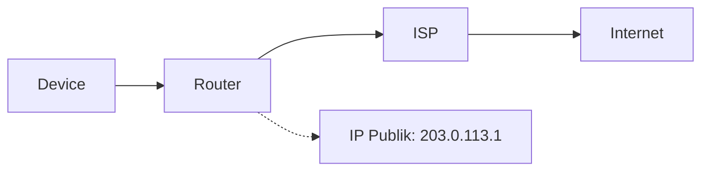
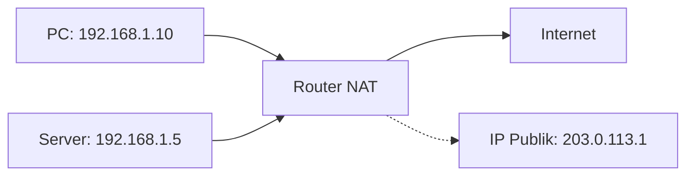
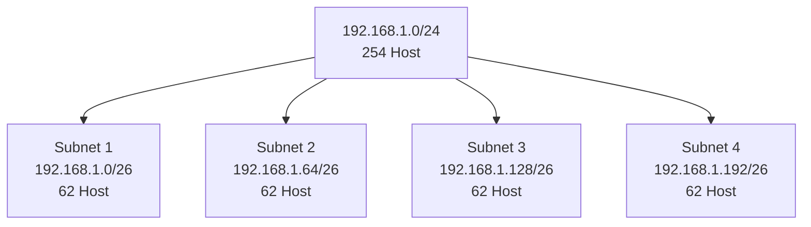

# Fundamental IP Address
## Pengalamatan Jaringan Komputer

<div class="pt-12">
  <span @click="$slidev.nav.next" class="px-2 py-1 rounded cursor-pointer" hover="bg-white bg-opacity-10">
    Mari mulai pelajaran! <carbon:arrow-right class="inline"/>
  </span>
</div>

---
layout: default
---

# Apa itu IP Address?

<v-clicks>

- **Internet Protocol Address** = Alamat unik setiap perangkat di jaringan
- Fungsi seperti **alamat rumah** di dunia digital
- Memungkinkan komunikasi antar perangkat
- Dikelola dalam sistem hierarki global

</v-clicks>

<div v-click="5" class="mt-8 p-4 bg-blue-50 rounded-lg">
💡 <strong>Analogi:</strong> IP Address seperti kode pos yang membantu postman mengirim surat ke alamat yang tepat
</div>

---
layout: defaults
---

# IPv4 vs IPv6

## IPv4
<v-clicks>

- **32-bit** (4 byte)
- Format: `192.168.1.1`
- **4.3 miliar** alamat
- Hampir habis 📉
- Masih dominan digunakan

</v-clicks>

## IPv6
<v-clicks>

- **128-bit** (16 byte)  
- Format: `2001:db8::1`
- **3.4×10³⁸** alamat
- Masa depan internet 🚀
- Adopsi bertahap

</v-clicks>

---
layout: center
class: 'text-center'
---

# Kelas IP Address
## Pembagian Berdasarkan Ukuran Jaringan

---

# Kelas A - Jaringan Besar

<div class="grid grid-cols-2 gap-8">

<div>

## Spesifikasi
- **Range:** `1.0.0.0` - `126.255.255.255`
- **Subnet Mask:** `255.0.0.0` atau `/8`
- **Network:** 126 buah
- **Host per Network:** 16.777.214

</div>

<div v-click>

## Penggunaan
- ISP besar
- Organisasi multinasional
- Infrastruktur internet

```
Contoh: 10.0.0.1/8
Network: 10.0.0.0
Host: 10.0.0.1 - 10.255.255.254
```

</div>

</div>

---

# Kelas B - Jaringan Menengah

<div class="grid grid-cols-2 gap-8">

<div>

## Spesifikasi
- **Range:** `128.0.0.0` - `191.255.255.255`
- **Subnet Mask:** `255.255.0.0` atau `/16`
- **Network:** 16.384 buah
- **Host per Network:** 65.534

</div>

<div v-click>

## Penggunaan
- Universitas
- Perusahaan besar
- Kampus

```
Contoh: 172.16.1.1/16
Network: 172.16.0.0
Host: 172.16.0.1 - 172.16.255.254
```

</div>

</div>

---

# Kelas C - Jaringan Kecil

<div class="grid grid-cols-2 gap-8">

<div>

## Spesifikasi
- **Range:** `192.0.0.0` - `223.255.255.255`
- **Subnet Mask:** `255.255.255.0` atau `/24`
- **Network:** 2.097.152 buah
- **Host per Network:** 254

</div>

<div v-click>

## Penggunaan
- Kantor kecil
- Rumah/SOHO
- LAN sederhana

```
Contoh: 192.168.1.1/24
Network: 192.168.1.0
Host: 192.168.1.1 - 192.168.1.254
```

</div>

</div>

---
layout: center
---

# IP Publik vs Privat
## Perbedaan Fundamental

---

# IP Address Publik

<v-clicks>

- **Dapat diakses dari internet** 🌐
- **Unik secara global** - tidak ada duplikasi
- **Dikelola oleh ISP** dan registry regional
- **Dapat dirutekan** di internet
- **Contoh:** `8.8.8.8` (Google DNS)

</v-clicks>

<div v-click="6" class="mt-8">



</div>

---

# IP Address Privat

<div class="grid grid-cols-2 gap-6">

<div>

## Range Privat RFC 1918
<v-clicks>

- **Kelas A:** `10.0.0.0/8`
- **Kelas B:** `172.16.0.0/12`  
- **Kelas C:** `192.168.0.0/16`

</v-clicks>

</div>

<div v-click="4">

## Karakteristik
- ❌ Tidak bisa dirutekan di internet
- ✅ Dapat digunakan berulang
- 🔄 Butuh NAT untuk akses internet
- 🏠 Ideal untuk jaringan internal

</div>

</div>

<div v-click="5" class="mt-6">



</div>

---
layout: center
---

# Subnet Mask & CIDR
## Membagi Network dan Host

---

# Subnet Mask

<v-clicks>

- **Fungsi:** Memisahkan bagian network dan host
- **Format:** Sama dengan IP address (4 oktet)
- **Binary:** 1 untuk network, 0 untuk host

</v-clicks>

<div v-click="4" class="mt-6">

## Contoh: 192.168.1.100/24

| Komponen | Decimal | Binary |
|----------|---------|--------|
| IP Address | 192.168.1.100 | 11000000.10101000.00000001.01100100 |
| Subnet Mask | 255.255.255.0 | 11111111.11111111.11111111.00000000 |
| Network | 192.168.1.0 | 11000000.10101000.00000001.00000000 |

</div>

---

# CIDR (Classless Inter-Domain Routing)

<div class="grid grid-cols-2 gap-6">

<div>

## Format CIDR
<v-clicks>

- **Notasi:** `IP/prefix`
- **Prefix:** Jumlah bit network
- **Contoh:** `192.168.1.0/24`

</v-clicks>

</div>

<div v-click="4">

## Konversi CIDR

| CIDR | Subnet Mask | Host Available |
|------|-------------|----------------|
| /24 | 255.255.255.0 | 254 |
| /25 | 255.255.255.128 | 126 |
| /26 | 255.255.255.192 | 62 |
| /27 | 255.255.255.224 | 30 |
| /28 | 255.255.255.240 | 14 |

</div>

</div>

---
layout: center
---

# Konsep Subnetting
## Membagi Jaringan Menjadi Segmen Kecil

---

# Tujuan Subnetting

<v-clicks>

- 🎯 **Efisiensi** - Optimalisasi penggunaan IP
- 🔒 **Keamanan** - Isolasi traffic antar subnet  
- ⚡ **Performance** - Mengurangi collision domain
- 👨‍💻 **Manajemen** - Memudahkan administrasi

</v-clicks>

<div v-click="5" class="mt-8">



</div>

---

# Contoh Subnetting: Membagi /24 menjadi 4 Subnet

<v-clicks>

**Jaringan Awal:** `192.168.1.0/24` (254 host)

**Target:** 4 subnet dengan ~60 host masing-masing

**Solusi:** Gunakan `/26` (62 host per subnet)

</v-clicks>

<div v-click="4" class="mt-6">

| Subnet | Network Address | Range Host | Broadcast |
|--------|----------------|------------|-----------|
| 1 | 192.168.1.0/26 | .1 - .62 | .63 |
| 2 | 192.168.1.64/26 | .65 - .126 | .127 |
| 3 | 192.168.1.128/26 | .129 - .190 | .191 |
| 4 | 192.168.1.192/26 | .193 - .254 | .255 |

</div>

---
layout: center
---

# Alamat Khusus
## Network, Broadcast, dan Lainnya

---

# Network Address

<v-clicks>

- **Definisi:** Alamat pertama dalam subnet
- **Fungsi:** Mengidentifikasi jaringan
- **Tidak dapat digunakan** untuk host

</v-clicks>

<div v-click="4" class="mt-6 text-center">

**Contoh:** `192.168.1.0/24`

Network Address = `192.168.1.0`

</div>

---

# Broadcast Address  

<v-clicks>

- **Definisi:** Alamat terakhir dalam subnet
- **Fungsi:** Mengirim data ke semua host
- **Tidak dapat digunakan** untuk host

</v-clicks>

<div v-click="4" class="mt-6 text-center">

**Contoh:** `192.168.1.0/24`

Broadcast Address = `192.168.1.255`

</div>

---

# Alamat Khusus Lainnya

<div class="grid grid-cols-2 gap-6">

<div>

## Loopback
<v-clicks>

- **Range:** `127.0.0.0/8`
- **Umum:** `127.0.0.1`
- **Fungsi:** Testing internal

</v-clicks>

</div>

<div v-click="4">

## APIPA
- **Range:** `169.254.0.0/16`
- **Fungsi:** Auto-IP tanpa DHCP
- **Windows:** Automatic Private IP

</div>

</div>

<div v-click="5" class="mt-8 p-4 bg-yellow-50 rounded-lg">
💡 <strong>Tips:</strong> Gunakan <code>ping 127.0.0.1</code> untuk test TCP/IP stack lokal
</div>

---
layout: center
---

# Perhitungan IP Address
## Rumus dan Contoh Praktis

---

# Menghitung Jumlah Host

<v-clicks>

**Rumus:** $2^{(32-prefix)} - 2$

**Mengapa -2?** 
- Network address
- Broadcast address

</v-clicks>

<div v-click="4" class="mt-8">

## Contoh Perhitungan

| CIDR | Bit Host | Perhitungan | Jumlah Host |
|------|----------|-------------|-------------|
| /24 | 8 | $2^8 - 2$ | 254 |
| /25 | 7 | $2^7 - 2$ | 126 |
| /26 | 6 | $2^6 - 2$ | 62 |
| /27 | 5 | $2^5 - 2$ | 30 |

</div>

---

# Menghitung Jumlah Subnet

<v-clicks>

**Rumus:** $2^{bits\_dipinjam}$

**Contoh:** Dari `/24` ke `/26`
- Bits dipinjam = 26 - 24 = 2
- Jumlah subnet = $2^2 = 4$

</v-clicks>

<div v-click="4" class="mt-8">

```mermaid {scale: 0.8}
graph TD
    A[/24 = 1 Network<br/>254 Host] 
    A --> B[/26 = 4 Network<br/>62 Host each]
    
    style A fill:#e1f5fe
    style B fill:#f3e5f5
```

</div>

---
layout: center
---

# VLSM
## Variable Length Subnet Mask

---

# Konsep VLSM

<v-clicks>

- **Definisi:** Subnet mask berbeda dalam satu jaringan
- **Keuntungan:** Efisiensi penggunaan IP
- **Fleksibilitas:** Sesuai kebutuhan host
- **Mengurangi pemborosan** alamat

</v-clicks>

<div v-click="5" class="mt-8 p-4 bg-green-50 rounded-lg">
💡 <strong>Prinsip:</strong> Alokasikan subnet sesuai kebutuhan, mulai dari yang terbesar
</div>

---

# Contoh VLSM

**Kebutuhan:**
<v-clicks>

- Subnet A: 50 host → `/26` (62 host)
- Subnet B: 25 host → `/27` (30 host)  
- Subnet C: 10 host → `/28` (14 host)
- Point-to-Point: 2 host → `/30` (2 host)

</v-clicks>

<div v-click="5" class="mt-6">

| Subnet | Kebutuhan | CIDR | Network | Range |
|--------|-----------|------|---------|-------|
| A | 50 | /26 | 192.168.1.0/26 | .1-.62 |
| B | 25 | /27 | 192.168.1.64/27 | .65-.94 |
| C | 10 | /28 | 192.168.1.96/28 | .97-.110 |
| P2P | 2 | /30 | 192.168.1.112/30 | .113-.114 |

</div>

---
layout: center
---

# Tips Praktis
## Troubleshooting & Best Practices

---

# Troubleshooting Step-by-Step

<v-clicks>

1. **Ping localhost** → Test TCP/IP stack
   ```bash
   ping 127.0.0.1
   ```

2. **Ping gateway** → Test koneksi router
   ```bash
   ping 192.168.1.1
   ```

3. **Ping DNS** → Test name resolution
   ```bash
   ping 8.8.8.8
   ```

</v-clicks>

---

# Best Practices

<div class="grid grid-cols-2 gap-6">

<div>

## Perencanaan
<v-clicks>

- 📝 **Dokumentasi** lengkap
- 🔄 **Reservasi** IP untuk ekspansi
- 📊 **Skema** yang konsisten

</v-clicks>

</div>

<div v-click="4">

## Keamanan
- 🏠 Private IP untuk internal
- 🔒 Segmentasi yang proper  
- 🛡️ Firewall rules yang tepat

</div>

</div>

<div v-click="5" class="mt-8 p-4 bg-blue-50 rounded-lg">
💡 <strong>Golden Rule:</strong> Selalu dokumentasikan skema IP addressing Anda!
</div>

---
layout: center
---

# Latihan Soal
## Test Pemahaman Anda

---

# Soal 1: Analisis Subnet

**Given:** IP `172.16.5.100/22`

**Tentukan:**
<v-clicks>

- Network Address?
- Broadcast Address?  
- Range Host yang valid?
- Jumlah total host?

</v-clicks>

<div v-click="5" class="mt-6 p-4 bg-gray-50 rounded-lg">
💡 Hints: /22 = 255.255.252.0, perhatikan oktet ke-3
</div>

---

# Soal 2: Subnetting

**Challenge:** Bagi `192.168.100.0/24` menjadi:
<v-clicks>

- **6 subnet** 
- **Minimal 25 host** per subnet
- Gunakan subnet mask yang tepat

</v-clicks>

<div v-click="4" class="mt-6 p-4 bg-gray-50 rounded-lg">
💡 Hints: Berapa bit yang dibutuhkan untuk 6 subnet? Berapa bit untuk 25 host?
</div>

---

# Soal 3: VLSM Design

**Requirement:** Desain VLSM untuk kebutuhan:
<v-clicks>

- **Sales Department:** 120 host
- **IT Department:** 50 host  
- **Management:** 15 host
- **Server Farm:** 8 host
- **2 Point-to-Point** links

</v-clicks>

<div v-click="6" class="mt-6 p-4 bg-gray-50 rounded-lg">
💡 Network: 192.168.0.0/24 - Alokasi efisien?
</div>

---
layout: center
class: 'text-center'
---

# Kesimpulan

<v-clicks>

- **IP Address = Identitas unik** setiap perangkat
- **Subnetting = Efisiensi** dan organisasi jaringan  
- **VLSM = Optimalisasi** penggunaan alamat
- **Practice makes perfect** 💪

</v-clicks>

<div v-click="5" class="mt-12">
  <h2>Terima Kasih!</h2>
  <p class="text-lg opacity-75">Questions & Discussion</p>
</div>

---
layout: center
---

# Referensi & Resources

<div class="grid grid-cols-2 gap-8 mt-8">

<div>

## RFC Documents
- RFC 791 - Internet Protocol
- RFC 1918 - Private Address Space
- RFC 4632 - CIDR

</div>

<div>

## Tools
- [IP Calculator](https://www.subnet-calculator.com/)
- [VLSM Calculator](https://vlsm-calc.net/)
- Packet Tracer / GNS3

</div>

</div>